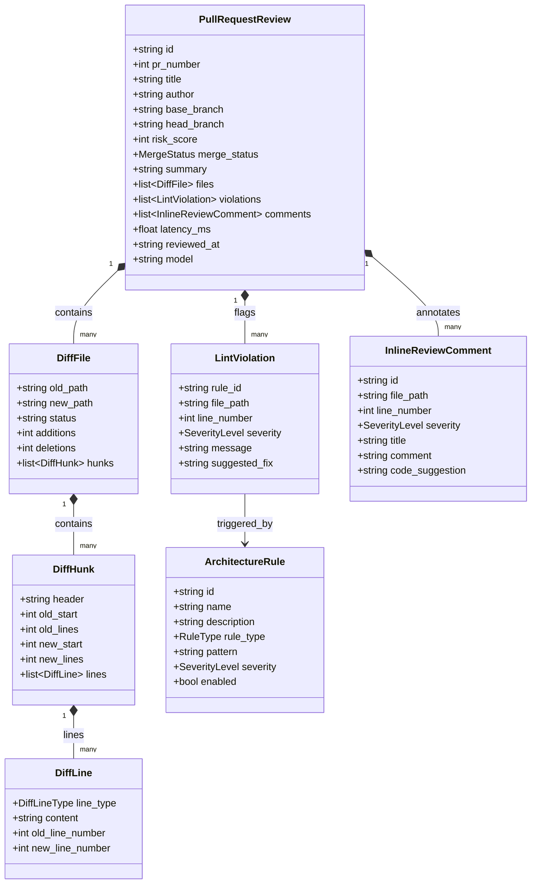

# DiffWise Data Model

This document outlines the domain entities, relationships, and data structures utilized by DiffWise for git diff parsing, architecture linting, and automated pull request reviews.

---

## 1. Domain Entity Relationship Diagram

---

## 2. Enums and Classification

### MergeStatus
- `APPROVED`: PR meets all architectural standards; risk score < 40 with 0 critical violations.
- `NEEDS_REVISION`: Moderate architectural warnings or missing tenant filters (risk 40-69).
- `BLOCKED`: Critical boundary inversions or plaintext credentials detected (risk >= 70).

### SeverityLevel
- `CRITICAL`: Immediate security vulnerability, secret leak, or layer inversion (blocking).
- `WARNING`: Architectural drift, missing tenant_id filter, or wildcard import.
- `INFO`: Style recommendation or minor optimization.

### RuleType
- `BOUNDARY`: Clean Architecture layer boundaries (e.g. Domain must not import API/Controller).
- `SECURITY`: Secret token exposure, authentication bypasses, tenant isolation.
- `SCHEMA`: Dangerous DDL operations or irreversible column drops.
- `COMPLEXITY`: Cyclomatic complexity spikes in PR additions.
